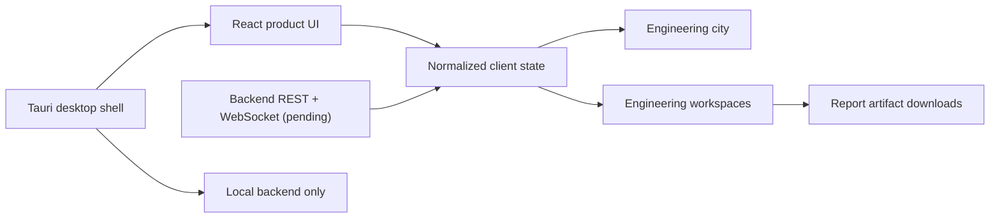

# ESCO Engineering City

Local-only engineering operations software for ESCO Group. The product shows project workflow and engineering review agents in an original, interactive multi-district 3D operations city while keeping evidence, findings, and human decisions central.

> The current product runs with clearly labeled synthetic demo data. Real API integration awaits the backend contract package.

## Product surfaces

- Engineering City — an immersive, edge-to-edge digital-twin home with a connected Three.js metro, moving traffic and pedestrians, a live synthetic workflow feed, a stable isometric map, and a street-level first-person walk mode
- Projects and Tasks — progress, blockers, dependencies, and approval state
- Findings & Evidence — exact source locations, confidence, risk, and comparison
- Approvals — explanation-gated human decisions
- Reports — real downloadable synthetic exports in demo mode
- Desktop — Windows-first Tauri wrapper with local-backend restrictions

## Architecture



## Local demo

Requirements: Node.js 20 or later and npm.

```powershell
.\scripts\product\setup.ps1
.\scripts\product\run-demo.ps1
```

Open `http://127.0.0.1:4173`. The interface labels synthetic information `DEMO DATA`; it does not perform or claim real engineering analysis.

## Development and testing

```powershell
.\scripts\product\dev.ps1
.\scripts\product\test.ps1
npm --prefix frontend run test:e2e
```

Install Rust and Tauri CLI before `.\scripts\product\build-desktop.ps1`.

## Security and scope

- Local-only; no telemetry or automatic cloud connection.
- Desktop backend validation permits loopback hosts only.
- No secrets in frontend bundles.
- No controller upload, download, online edit, or control.
- AI output is advisory; engineering approval requires an authorized human record.
- Demo inputs are synthetic.

Intended normalized evidence includes L5X, XML, CSV, XLSX, DOCX, and PDF. Parser support is backend-defined and not yet connected. FactoryTalk runtime validation, physical-behavior simulation, controller control, and automatic engineering approval are unsupported.

See [product guide](docs/product/PRODUCT.md) and [GPT handoff](docs/handoffs/GPT.md).
