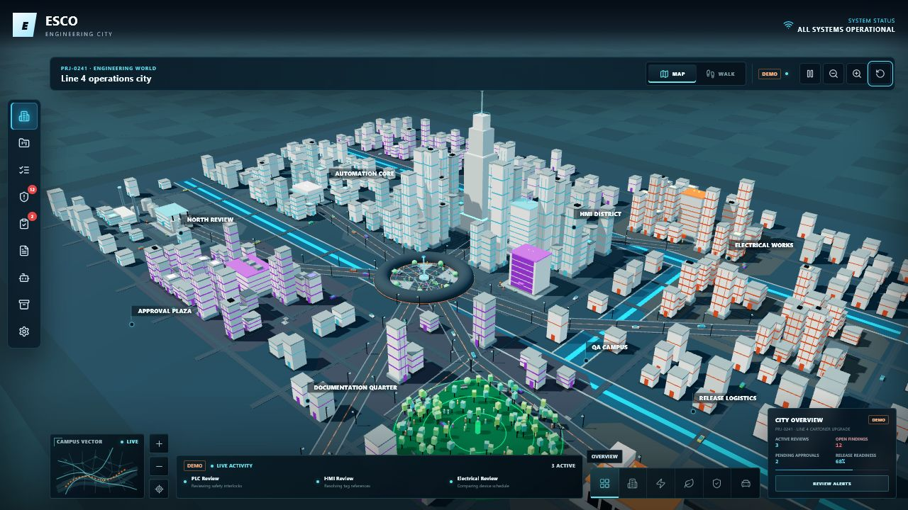
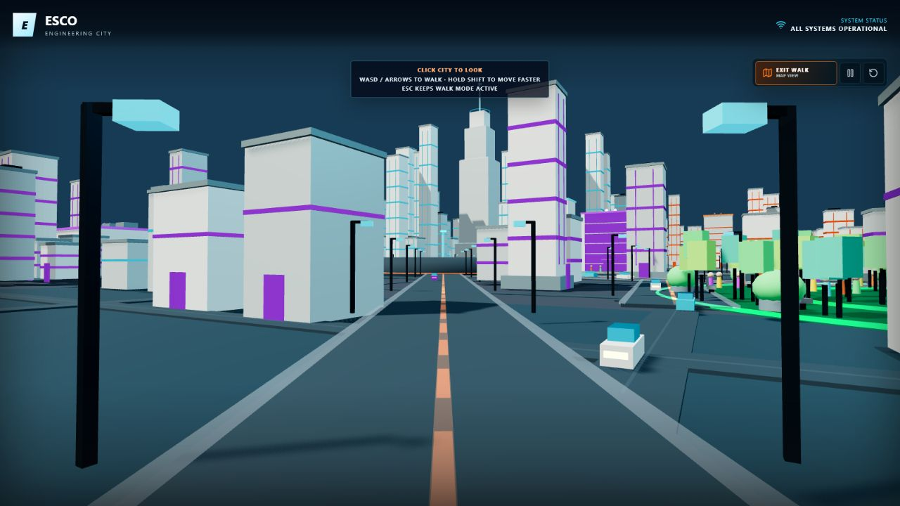

# Product guide

ESCO Engineering City is a local engineering-operations workspace. Its multi-district city explains workflow state; findings and source evidence remain the center of the experience.

## Principles

- Agent positions derive from semantic workflow state, never random movement.
- The home is an immersive Three.js WebGL digital-twin world with a central skyline, eight workflow districts, hundreds of deterministic instanced buildings, connected metropolitan blocks, roads, bridges, waterways, industrial and logistics infrastructure, and layered system overlays.
- The city is visibly active: deterministic demo traffic moves in both directions, pedestrians circulate through the plaza, park, and engineering forecourts, water and workflow routes pulse, and building beacons/windows change over time. Pause and reduced-motion freeze this ambient activity.
- The overview opens close to the skyline so the city reads at metropolitan scale while retaining the broad flat-world horizon, then supports free 360° drag orbit plus wheel or pinch zoom without requiring first-person mode. Reset restores the opening composition, while a separate first-person mode provides street-level exploration.
- Its visual language uses a daylight-blue environment, continuous block-tiled terrain, luminous cyan infrastructure and water, orange mobility routes, purple district accents, and varied green public space. The subtle chunk variation gives the surrounding world a voxel-built scale without reintroducing a global black grid or visible platform edges.
- The city-first chrome is one coherent spectator interface: a compact navigation rail, unified command bar, lightweight spatial labels, a small minimap, a clearly marked synthetic activity strip, compact layers, and an operational summary frame the world without shrinking it into a dashboard card.
- Demo records are always marked `DEMO DATA`.
- AI recommendations are advisory and never imply approval.
- Critical decisions require an authorized reviewer and recorded rationale.
- No controller upload, download, online edit, or control functions exist.
- Demo mode has no external network dependency.

## Demonstration

1. Run `scripts/product/run-demo.ps1` and open `http://127.0.0.1:4173`.
2. Use **Map** to inspect the connected city. Drag anywhere on the world to orbit 360°, use the wheel or a pinch gesture to zoom, and choose **Reset city view** to restore the opening composition.
3. Watch the synthetic traffic, pedestrians, water packets, workflow routes, and activity strip. Pause the timeline to freeze all ambient city motion.
4. Choose **Walk**, click the world to enable mouse look, move with WASD or the arrow keys, and hold Shift to move faster. Press Escape to release the cursor and **Exit walk** to return to the map.
5. Open Findings, select `F-107`, and compare evidence.
6. Open Approvals; submit remains disabled until a decision is selected.
7. Open Reports and generate a synthetic, clearly marked export.

The visualization uses named native controls alongside map zoom, raycast selection, and first-person navigation. System reduced-motion preferences and the explicit reduced-motion option stop animation.
